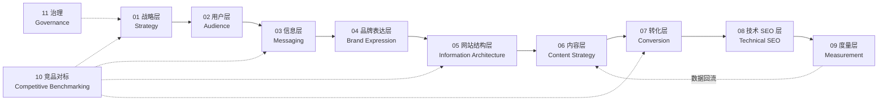

# FHS 网站设定集

> [!NOTE]
> 本设定集是 FHS 网站从战略到执行的唯一依据。所有页面、文案、模板和竞品对标，都以这里的设定为准；与此冲突的旧文档以本设定集为准。

## 文档结构

设定集顺着建站逻辑展开：先定战略和用户，再定说什么、怎么说，然后落到结构、内容、转化、技术和度量。竞品对标单独成一部分，贯穿全篇。

## 每章的统一结构

凡是标有 ★ 的小节，都按同一个三段式来写，方便横向对比竞品：

| 段落 | 回答的问题 |
| --- | --- |
| **FHS 设定** | 我们怎么做 |
| **竞品做法** | 对标对象各自怎么做（详细记录在第十部分的对标矩阵） |
| **对标结论** | 跟 / 超 / 避 / 补 |

对标结论的四种判定：

| 判定 | 含义 | 典型情况 |
| --- | --- | --- |
| **跟** | 门槛项，大多数竞品都有，我们必须有 | 产品实拍图、按品类展开的产品页 |
| **超** | 大家都在做，我们做得明显更好 | 知识文章写得更懂采购、表单更省事 |
| **避** | 竞品常做，但违反我们的设定，刻意不做 | 堆空泛口号、照搬原厂参数表 |
| **补** | 竞品普遍没做好的空白，由我们补上 | 面向经销商、系统集成商的专门内容 |

## 状态标记

| 标记 | 含义 |
| --- | --- |
| ★ | 可横向对比竞品的小节 |
| `已定` | 已与客户确认 |
| `待确认` | 需要 Nina 提供事实或确认 |
| `待写` | 本批次尚未撰写 |

## 批次计划

| 批次 | 范围 | 状态 |
| --- | --- | --- |
| 第一批 | 01–04 部分、10 部分（已用 R0–R7 研究数据回填） | 完成 |
| 第二批 | 05–09 部分 | 完成（本版） |
| 研究 | R0–R6 市场与竞品研究（Codex 执行）、R7 综合结论与决策 | 完成 |
| 持续 | 11 部分治理、待确认事项、变更记录 | 随时更新 |

## 来源标记

| 标记 | 含义 |
| --- | --- |
| `工具数据` | 来自关键词、SERP、流量工具的数据，是估算值 |
| `网页展示` | 来自竞品页面的公开展示，是它们的自述 |
| `分析判断` | 基于数据的判断，不是新数据 |
