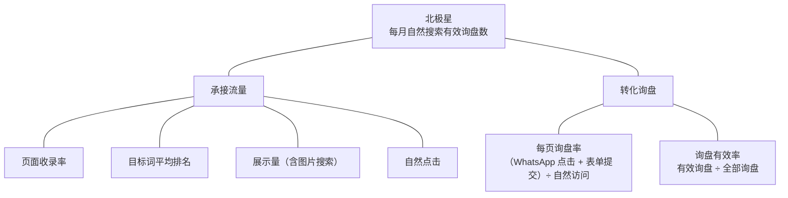
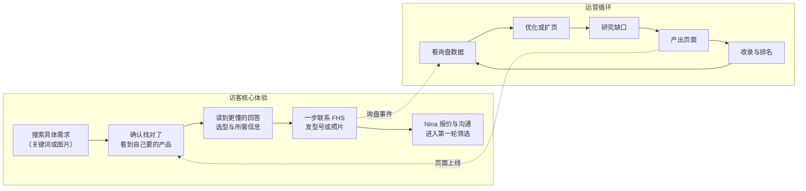

# 01 战略层 Strategy

战略层回答三个问题：网站要成为什么、用什么衡量成败、在市场里站在哪个位置。后面所有章节都从这里推导，冲突时以本章为准。

## 1.1 Vision Statement 愿景陈述

`已定`

**让在搜索引擎上寻找过滤产品的海外采购者，一眼看到 FHS 有他要的产品，并把 FHS 放进第一批询价名单。**

网站是 FHS 的获客入口：负责让采购者找到 FHS、看到产品、发出询价；之后的报价、沟通和成交，由 Nina 十几年的外贸销售能力完成。

> [!TIP]
> 判断任何页面或模块是否值得做，先问一句：它是否让采购者更快地“看到产品、放进询价名单”？

## 1.2 North Star Metric 北极星指标

`已定`

**北极星：每月来自自然搜索的有效询盘数。**与 5 个核心品类相关的过滤产品询盘都算有效；WhatsApp 对话和表单提交都计入。

北极星由“承接流量”和“转化询盘”两段链路驱动，每段各有输入指标，用来定位问题出在哪一段。



| 链路 | 输入指标 | 数据来源 |
| --- | --- | --- |
| 承接流量 | 收录率、目标词平均排名、展示量、自然点击 | Google Search Console |
| 转化询盘 | 每页询盘率、询盘有效率 | GA4 事件 + Nina 的询盘记录 |

**诊断顺序**：先看收录，再看排名和点击，最后看询盘率。哪一段掉了，就只修那一段。

## 1.3 Positioning Statement 定位陈述 ★

`已定`

**FHS 是海外 B2B 采购者在中国的高性价比过滤产品合作伙伴**：从全国各地的优势工厂，为每个需求挑选最合适的货源，一个对接人负责到底。

| 要素 | 内容 |
| --- | --- |
| 目标客户 For | 海外的过滤产品经销商、贸易商、配件商，以及采购组件自行组装系统的系统集成商、工程商；其次是有替换需求的终端工厂 |
| 需求 Who need | 稳定、有转售空间的过滤产品货源 |
| 品类 Is a | 专注滤芯、滤袋、滤壳、滤膜、滤纸 5 个核心品类的中国采购合作伙伴 |
| 利益 That | 有竞争力的价格、按需求匹配的工厂、一个人对接从报价到发货 |
| 对比 Unlike | 国际大品牌：价格高、交期长；单一中国工厂：品类不全、只推自己的货 |
| 理由 Because | 十几年过滤产品外贸经验，长期合作的工厂资源 |

**英文版**（内部对齐用，不直接上首页）

> For filtration distributors, resellers and system integrators who need reliable filter cartridges, bags, housings, membranes and filter paper at prices that leave room to resell, FHS is a China-based filtration sourcing partner that matches every request to the best-fit factory and handles it through one point of contact. Unlike global brands, we are flexible on price and lead time; unlike a single factory, we don't push one product line — we pick the right source for each job.

**不使用 Manufacturer 定位** `已定`（2026-10-15）：首页、关于页、标题、公司简介一律不称 FHS 为 manufacturer / factory。原 IA 中首页主词 “industrial filtration manufacturer” 月搜索量 30、KD 53，几乎没有 SEO 价值，却与“多厂匹配的采购合作伙伴”定位冲突（见 R7 第 5 节）。可以如实描述合作工厂的能力，但不能写成 FHS 自有。

**对标关注点**：竞品如何介绍自己（制造商、经销商、采购服务）；首屏第一句话说的是什么；是否点明服务哪类买家。

## 1.4 Product Scope 产品范围 ★

`已定`

| 层级 | 品类 | 本期处理方式 |
| --- | --- | --- |
| **核心品类** | 滤芯 filter cartridges、滤袋 filter bags、滤壳 filter housings、滤膜 membranes、滤纸 filter paper | 完整建设、推广、提交收录。滤膜由骨架页升级为完整建设 `已定`（2026-10-15） |
| **暂缓品类** | 实验室过滤 lab filtration | 只搭框架，noindex，不推广；后续整理高利润、高复购产品后再上线 |
| **非核心** | 过滤配件 filtration accessories（不突出泵） | 一个页面，noindex，不推广，避免内容分散 |
| **行业优先级** | 酒类（啤酒、葡萄酒、苹果酒、蒸馏酒）> 软饮料（可乐、果汁等）> 食用油 | 前两类本期建设；食用油往后放 |

**替代需求的范围**：客户要替代的不只是国际巨头，还有全球中小品牌、当地品牌，甚至中国品牌。

- 通用入口：“不管现在用哪个品牌，把型号发过来”。
- 单独成页的国际巨头：Pall、3M（不写 CUNO）、Parker、Pentair、Eaton、Sartorius、Millipore。

**对标关注点**：竞品覆盖哪些品类、品类深度如何；是否把替代需求做成独立板块。

## 1.5 Differentiation Strategy 差异化策略 ★

FHS 夹在两类对手之间，差异化要同时回答“为什么不找大品牌”和“为什么不直接找中国工厂”。

```quadrant
title: 采购者眼中的供应商选择
x: 品类覆盖窄 -> 品类覆盖广
y: 价格高、灵活度低 -> 价格优、灵活度高
q1: FHS 的目标位置
q2: 单一中国工厂
q3: 小型专业厂
q4: 国际品牌与大型经销商
point: 国际原厂 | 0.78 | 0.16
point: 欧美经销商 | 0.86 | 0.34
point: 中国单一工厂 | 0.24 | 0.70
point: FHS（目标） | 0.80 | 0.80
```

> [!WARNING]
> 图中位置是定性的示意，不是测量数据。FHS 的位置是目标，需要靠产品页、证据和转化体验去兑现。

| 差异化杠杆 | 对国际品牌 | 对单一中国工厂 | 需要的证据 |
| --- | --- | --- | --- |
| 价格 | 有转售空间的价格 | 持平或更优（多厂比价） | 价格优势来源的说明 `待确认` |
| 品类 | 5 个核心品类覆盖接近 | 一处配齐，不受单厂限制 | 5 个品类的产品页与实拍图 |
| 匹配 | 可替代任何品牌型号 | 按需求挑最合适的工厂 | 匹配流程说明、替代案例 `待确认` |
| 服务 | 一对一，24 小时内回复 | 一个对接人，懂外贸 | 回复时效 `已定`：24 小时内 |
| 质量把关 | 先样品后批量 | 多厂比较，验货把关 | 验货流程、照片、检测文件 `待确认` |

**对标结论**（依据第十部分与 R7）：

- **品类与产品资料是“跟”**：产品页的面包屑、首段回答、产品图库、行动按钮、结构化数据，5–6 家对手都有。
- **匹配能力与客户分流是“补”**：替代说明、尺寸细节图、商标声明、具名对接人、长尾入口、按客户类型分流，对手几乎都没做（产品页 0–1/6）。
- **询价体验是“超”**：6/6 家都有询价表单，但只有 2 家做得好。
- **替代能力的价值在转化，不在 SEO**：替代类搜索的前十里，原厂自己占 42.5%，中国网站只占 3.75%。FHS 的替代页是询价入口；SEO 只攻“品牌 + 产品类型”的组合词（参照 Filson 以 “cuno filter housing” 排第 1）。

## 1.6 Core Loop 核心循环

网站的核心体验是访客的五步，运营循环用询盘数据持续改进页面。



网站只负责前四步，第五步是 Nina 的强项。采购者通常同时问很多家，第一轮靠价格和回复速度筛选，所以第四步的门槛越低、Nina 回复越快，进入下一轮的机会越大。
