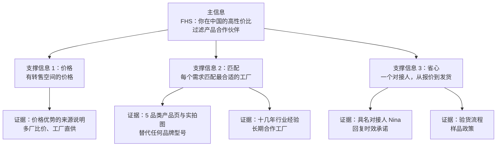

# 03 信息层 Messaging

信息层定义“说什么”：主信息是什么、用什么支撑、用什么证据兑现。每一句对外的话，都要能追溯到这里的某条信息和某个证据。

## 3.1 Value Proposition Canvas 价值主张画布 ★

**核心主张：同样的过滤产品，更有竞争力的价格，更省心的采购。**

英文首页候选：*Filtration products sourced from the right factory in China — priced to compete, handled by one person.*

### 按客户类型展开

| 客户类型 | 要完成的事 Jobs | 痛点 Pains | 期望 Gains | FHS 的痛点解法 Pain relievers | FHS 的收益创造 Gain creators |
| --- | --- | --- | --- | --- | --- |
| 经销商、贸易商、配件商 | 补货、扩品类、赚转售利润 | 品牌货利润薄；中国货源质量不稳、沟通费劲 | 稳定货源、利润空间、少操心 | 多厂比价、一个对接人、验货把关 | 5 品类一处配齐、混批、中性包装 `待确认` |
| 系统集成商、工程商 | 按设计规格配齐组件、按项目交付 | 多处采购、规格对不上、交期拖项目 | 一次报齐、规格准确、交期可控 | 按清单匹配规格、交期提前讲清 | 滤壳、滤芯、滤袋、膜一站配齐 |
| 终端工厂 | 稳定替换现有耗材 | 原厂贵、交期长；怕换货影响生产 | 降本、不影响质量、文件齐全 | 按型号或照片匹配、先样品后批量 | 懂工况的建议、可提供的出口文件 `待确认` |

**对标关注点**：竞品首页和产品页的主张是什么；是否区分不同客户；主张有没有具体兑现方式。

## 3.2 Messaging Hierarchy 信息层级

| 层级 | 内容 | 出现位置 |
| --- | --- | --- |
| 主信息 | FHS 是你在中国的高性价比过滤产品合作伙伴 | 首页首屏、关于页、公司简介、页脚 |
| 支撑信息 1 价格 | 有转售空间的价格 | 首页、经销商页、产品页询价模块 |
| 支撑信息 2 匹配 | 每个需求匹配最合适的工厂，替代任何品牌 | 首页、产品页、替代页、集成商页 |
| 支撑信息 3 省心 | 一个对接人负责从报价到发货 | 首页、联系模块、关于页 |

**规则**：一个页面只突出一条支撑信息，其余两条在共用组件里出现即可，避免每页都在重复所有卖点。

## 3.3 Proof Point Library 证据库 ★

主张必须有事实撑着，否则就是空口号。上线前逐条确认，没有证据的主张不上页面。

| 编号 | 主张 | 证据形式 | 用在哪里 | 状态 |
| --- | --- | --- | --- | --- |
| P01 | 十几年行业经验 | 具体起始年份 | 首页、关于页、公司简介 | `待确认` 具体年份 |
| P02 | 价格有竞争力 | 价格优势来源说明（不写折扣比例） | 首页、经销商页 | `待确认` 表述 |
| P03 | 5 个品类配得齐 | 产品页 + 实拍图 | 产品页、首页品类区 | `待确认` 工厂图册与图片 |
| P04 | 替代任何品牌 | 替代流程说明、已替代过的品牌类型 | 替代页、产品页 | `待确认` |
| P05 | 回复快 | 24 小时内回复（照顾全球时差，不承诺报价时间） | 联系模块、表单 | `已定` |
| P06 | 质量有把关 | 验货流程、验货照片、工厂可提供的检测文件 | 关于页、产品页 | `待确认` |
| P07 | 先样品后批量 | 样品政策 | 产品页、终端工厂页 | `待确认` |
| P08 | 小批量、混批 | 起订量政策 | 经销商页、产品页 | `待确认` |
| P09 | 出口经验 | 出口过的国家或地区 | 关于页 | `待确认` |
| P10 | 长期合作 | 合作最久的客户年数 | 关于页 | `待确认` |
| P11 | 付款方式稳妥 | 可接受的付款方式 | 关于页、FAQ | `待确认` |
| P12 | 规格说得清、能核对 | 5 个品类的规格范围（材质、精度、尺寸、端盖、接口、工况）与尺寸参照图、端盖细节图 | 产品页、替代页 | `待确认` 工厂规格资料 |

> [!TIP]
> **P12 与 P03 是最高优先级的素材。**竞品研究显示，核心采购流量来自产品资料扎实的品类页和产品页；而尺寸细节图（M04）在对手的产品页上是 0/6，是最直接的“补”（见 R7）。

> [!WARNING]
> 竞品的年限、认证、交期、客户数都是它们的自述，不能挪用成 FHS 的承诺。FHS 页面上的每一个数字都要能兑现。

**对标关注点**：竞品用了哪些证据；哪些是具体事实、哪些是空泛宣传；哪类证据几乎人人都有（门槛）。

## 3.4 Objection Handling Matrix 异议处理矩阵

采购者在第一轮筛选时会有的顾虑，以及网站上如何提前回应。

| 异议 | 主要来自 | 网站上的回应方式 | 依赖的证据 |
| --- | --- | --- | --- |
| 中国货质量会不会不稳定？ | 经销商、终端工厂 | 说明验货流程；先样品后批量 | P06、P07 |
| 你们不是工厂，会不会多一层加价？ | 经销商、集成商 | 说明多厂比价和匹配的价值：省下的是找厂、比价、沟通的时间和风险 | P02、P04 |
| 规格会不会匹配错？ | 集成商、终端工厂 | 说明确认流程：先核对型号、尺寸、材质，再报价 | P04 |
| 替代品能不能真的替换原厂？ | 终端工厂 | 只陈述兼容关系，提供样品测试，不承诺“完全一样” | P04、P07 |
| 起订量太大怎么办？ | 经销商 | 说明起订量和混批政策 | P08 |
| 出了问题找谁？ | 所有人 | 具名对接人，一个人负责到底 | P05 |
| 文件够不够应付审核？ | 终端工厂（食品饮料） | 列出可以提供的文件类型，不夸大 | P06 |

## 3.5 Company Boilerplate 公司标准简介

三个长度版本，用于不同位置。方括号内的年份和地区，以及“出货前验货”的说法，依赖证据 P01、P06、P09，待 Nina 确认后才能上线。

**短版（约 20 词，用于页脚、社媒简介）**

> FHS is a China-based filtration sourcing partner supplying filter cartridges, bags, housings, membranes and filter paper to distributors and system integrators worldwide.

**中版（约 50 词，用于关于页开头、开发信签名）**

> FHS helps filtration distributors, resellers and system integrators source filter cartridges, bags, housings, membranes and filter paper from China. With [X] years in filtration trade, we match each request to the best-fit factory, check quality before shipment, and handle everything through one point of contact.

**长版（约 100 词，用于关于页、平台介绍）**

> FHS is a China-based filtration sourcing partner. For more than [X] years, we have supplied filter cartridges, filter bags, filter housings, membranes and filter paper to distributors, trading companies, system integrators and end users across [regions]. Instead of pushing one factory's catalog, we work with long-term partner factories across China and match each request to the source that fits it best — whether you need a replacement for a global brand, a full component list for a new system, or steady restocking at prices that leave room to resell. One contact handles your request from quotation to shipment.
