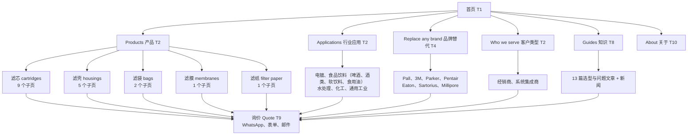
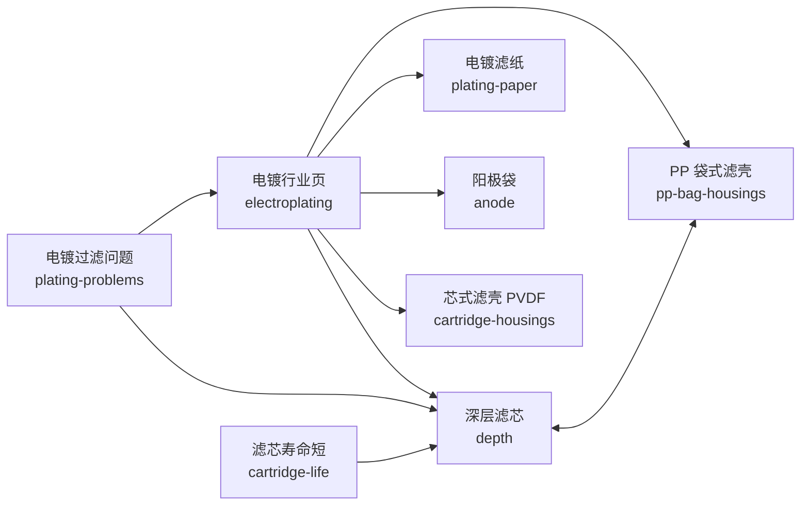

# 05 网站结构层 Information Architecture

网站结构层定义“页面怎么组织”：有哪些页面、每类页面放哪些模块、怎么导航、怎么互相链接、URL 怎么命名。逐页的路径、关键词和备注见 [IA map](#c-ia)（v2.1），本章定规则，IA map 记明细。

## 5.1 Sitemap 站点结构

`已定`

**网站按“产品、行业、替代、客户类型、知识”五条入口组织，所有入口最终都汇到同一个询价动作。**采购者从哪条路进来都可以，但每条路的终点都是“发型号或照片给 Nina”。

**页面规模**

| 类别 | 数量 | 说明 |
| --- | ---: | --- |
| 建设并收录 | 68 | 首页 1 + 栏目入口 5 + 栏目页 62 |
| 建设但 noindex | 2 | 实验室过滤 `lab`、过滤配件 `accessories` |
| 不建页 | 2 | 压滤机 `presses`（2027 新系列）、案例 `cases`（有授权案例后再建） |

> [!NOTE]
> 与 IA v2 的差异（v2.1）：滤膜两页升级为完整建设（IA-Q1）；首页、关于页去掉 Manufacturer 定位（IA-Q4）；回复时效定为 24 小时内，不写“4 小时报价”（IA-Q3）。

## 5.2 Page Type Inventory 页面类型清单

`已定`

| 模板 | 名称 | 页数 | 主要意图 | 主要读者 | 页面的任务 |
| --- | --- | ---: | --- | --- | --- |
| T1 | Home 首页 | 1 | 品牌词、导航 | 所有人 | 一眼说清 FHS 是谁，按产品、客户类型、替代分流 |
| T2 | Section hub 栏目入口 | 3 | 导航 | 所有人 | 产品、行业、客户类型三个栏目的入口 |
| T3 | Product landing 产品页 | 25（其中 noindex 2） | 采购、规格 | 经销商、系统集成商 | **承接核心采购流量的主力**；写清有什么、怎么选、能替代什么 |
| T4 | Cross-reference 替代页 | 8 | 替代 | 终端工厂、经销商 | 询价入口：发型号或照片，任何品牌 |
| T5 | Application 行业页 | 9 | 应用 | 终端工厂、系统集成商 | 从工况出发，说明每个工位用什么产品 |
| T6 | Customer type 客户类型页 | 2 | 业务入口 | 经销商、系统集成商 | 主动获客的落地页；回应该类客户的顾虑 |
| T7 | Article 文章 | 14 | 知识、规格 | 所有人（早期） | 接选型长尾词，把读者送到产品页 |
| T8 | Archive 列表 | 2 | 导航 | — | 知识栏目入口、新闻列表 |
| T9 | Tool 工具 | 2 | 转化 | 所有人 | 询价页、产品范围总览 |
| T10 | Company & legal 公司与法律 | 4 | 信任 | 已有兴趣的买家 | 关于、技术支持、隐私、条款 |
| 合计 | | 70 | | | 收录 68 + noindex 2；不建页的 2 个不计入 |

> [!TIP]
> 研究显示核心采购流量来自扎实的品类页和产品页（R7 第 2 节）。**T3 是整站投入最大的模板**，T7 只写与采购选型相关的题，不追与采购无关的流量。

## 5.3 Template Specifications 模板规范 ★

本节是各模板模块与顺序的唯一依据，取代 IA map 末尾的 v1 列表。模块编号沿用竞品对标的 M01–M27（定义见第十部分）。

### 共用组件

共用组件只做一次，所有模板调用同一份，改一次全站生效。

| 编号 | 组件 | 包含模块 | 说明 |
| --- | --- | --- | --- |
| C1 | 联系模块 | M19 表单、M20 WhatsApp、M21 具名对接人、M22 回复时效 | Nina 照片与第一人称一句话；表单三字段 + 可选上传；*Reply within 24 hours* |
| C2 | 长尾入口 | M23 | *Can't find it? Send a photo of your old filter.* |
| C3 | 商标声明 | M11 | 品牌名归各自所有者，FHS 与其无隶属关系，品牌名只用于说明兼容 |
| C4 | 移动端固定栏 | M18、M20 | 底部固定：WhatsApp + *Send request* |
| C5 | 证据条 | M13 | 只放已确认的证据（见 3.3），未确认的条目不显示，不留占位 |
| C6 | 面包屑 | M01 | 除首页外全站 |
| C7 | 页脚 | — | 5 品类、行业、替代品牌、公司、法律、短版公司简介 |

### T3 产品页（分类变体与产品变体共用）

| 顺序 | 模块 | 内容要求 | 对标判定 |
| ---: | --- | --- | --- |
| 1 | C6 面包屑 | — | 跟（5/6） |
| 2 | M02 H1 + 首段 | H1 含主关键词；首段 ≤ 60 词，说清供应什么、给谁、发什么信息就能报价；首屏放主 CTA | 跟（6/6） |
| 3 | M03 实拍图库 + M04 细节与尺寸图 | 至少 4 张：整体、端盖或接口、细节、尺寸标注 | M03 跟（5/6）；**M04 补（0/6）** |
| 4 | M05 类型与系列 | 分类变体：子产品卡片网格；产品变体：按材质或结构分节 | 超（4/6） |
| 5 | M06 规格范围表 | 材质、精度范围、长度与外径、端盖与接口、温度与压差；写范围，不做参数数据库 | 观察（3/6） |
| 6 | M09 怎么选 | 3–5 条选型要点，回答该品类的 PAA 问题 | **补（0/6）** |
| 7 | M10 能替代什么 + C3 | 只列已核验的品牌与产品系列；没有核验数据时写“发型号或照片” | **补（0/6）**，M11 补（0/6） |
| 8 | M08 应用场景 | 链接到对应行业页 | 超（6/6） |
| 9 | M16 采购流程 | 样品、起订量、交期、付款；数值 `待确认` 前只写流程不写数字 | 观察（3/6） |
| 10 | C5 证据条 | 验货、包装照片（已确认后） | 观察（3/6） |
| 11 | M17 FAQ | 3–5 问，优先用 PAA 原问题 | 观察（2/6） |
| 12 | C1 联系模块 + C2 长尾入口 | 需求提示按品类改写 | M19 超；M21、M23 补 |
| 13 | M24 相关产品 + M25 相关文章 | 同级产品 2–4 个、文章 1–3 篇 | 观察 |

**刻意不做**：M07 订货编码表（FHS 没有成体系的型号目录，不编造）；M14 年限和客户数堆砌。

### T4 替代页（总页与品牌页）

| 顺序 | 模块 | 内容要求 | 对标判定 |
| ---: | --- | --- | --- |
| 1 | C6 面包屑 | — | 观察 |
| 2 | M02 H1 + 首段 | 品牌页：*[Brand] [product type] replacements*；总页：任何品牌都可以 | 跟（2/2） |
| 3 | 型号输入框 | 型号 + 照片上传 + 数量，一步提交（C1 的变体） | 超 |
| 4 | M05 可替代的产品族 | 按产品类型列出，链接到对应 T3 | 观察 |
| 5 | M10 已核验型号 | 只放 Nina 核验过的；没有时显示“发型号，我们来核对”的空态 | 跟（2/2） |
| 6 | M04 拍照与测量指引 | 型号不全时拍哪几处、量哪些尺寸，配示意图 | **补（0/2）** |
| 7 | M16 匹配流程 | 型号或照片 → 核对规格 → 样品 → 报价 | 观察 |
| 8 | 能匹配与不能匹配 | 说清边界：不提供原厂授权文件、不承诺完全一样 | — |
| 9 | C3 商标声明 | 必须有 | **补（0/2）** |
| 10 | M24 相关产品、M17 FAQ、C1 | — | 跟 |

**禁止**：原厂 logo、原厂产品图、*100% identical*、*same as original*。

### T5 行业页

| 顺序 | 模块 | 内容要求 | 对标判定 |
| ---: | --- | --- | --- |
| 1 | C6、M02 | H1 含行业 + filtration；首段说清这个行业在哪些工位需要过滤 | 跟（3/4） |
| 2 | M08 工艺流程图 | 用流程图标出过滤器所在工位 | 超（4/4） |
| 3 | 每个工位的产品 | 表格：工位 → 推荐品类与精度 → 链接 T3 | — |
| 4 | M09 常见错误与选型要点 | 懂工况的判断；不把通用判断写成工程批准 | 观察 |
| 5 | M12 可提供的文件 | 食品饮料页列出能提供的文件类型（`待确认` Q05） | **补（0/4）** |
| 6 | M16 报价边界 | 说清 FHS 报组件，不报整套系统造价（对应研究缺口“industrial system cost”） | 观察（1/4） |
| 7 | M15 案例 | 只有真实、获授权案例时才放 | 补（0/4），`待确认` |
| 8 | M17 FAQ、C1 | CTA：*Send what you use now* | — |

### T6 客户类型页

| 顺序 | 模块 | 经销商页 | 系统集成商页 |
| ---: | --- | --- | --- |
| 1 | M02 H1 + 首段 | 生意人对生意人：价格空间、混批、包装 | 工程化：按清单配齐、一次报齐 |
| 2 | 痛点与回应 | 利润薄、中国货源不稳 | 多处采购、规格对不上、交期 |
| 3 | M05 供应范围 | 5 品类入口 | 滤壳 + 滤芯 + 滤袋 + 膜的组合 |
| 4 | M16 合作流程 | 补货流程；中性包装、不在货里夹带联系方式 `待确认` | 清单 → 匹配 → 报价 → 交期确认 |
| 5 | C5 证据条 | 验货、稳定供货 | 规格核对流程 |
| 6 | C1 联系模块 | 需求提示：*Send your product list* | 需求提示：*Send your component list*，支持上传 Excel 或图纸 |

对标：T6 只有 1 家竞品有，M26 客户分流、M21 具名、M22 时效、M16 流程均判“补”。**T6 页面同时是开发信和 LinkedIn 的落地页**，页面不依赖导航也能独立成立。

### T7 文章

| 顺序 | 模块 | 内容要求 |
| ---: | --- | --- |
| 1 | C6、M02 | 标题即问题；首段 2–3 句直接给答案 |
| 2 | 目录 | 超过 4 个 H2 时显示 |
| 3 | 正文 | 表格、对比、示意图优先于大段文字 |
| 4 | M09 决策要点 | 可直接照做的检查清单 |
| 5 | 产品插卡 | 正文中至少 1 处链接到对应 T3，首屏内出现一次 |
| 6 | C2 长尾入口 | 研究判“补”（0/5） |
| 7 | M25 相关文章、C1 精简版 | — |

### T1 首页

| 顺序 | 模块 | 内容要求 | 对标判定 |
| ---: | --- | --- | --- |
| 1 | Hero | 主信息（3.2）+ 5 品类 + 主 CTA *Send your model or photo* + WhatsApp；不称 manufacturer | 跟 |
| 2 | M05 品类入口 | 5 个品类卡片，带实拍图 | 超（4/6） |
| 3 | M26 客户类型分流 | 经销商 → 经销商页；系统集成商 → 集成商页；终端工厂 → 行业页 | **补（0/6）** |
| 4 | 替代入口 | 任何品牌 + 7 个品牌页链接（文字，不用 logo） | 补（1/6） |
| 5 | M16 合作方式 | 发需求 → 匹配工厂 → 样品 → 验货 → 发货 | 观察（3/6） |
| 6 | M08 行业入口 | 酒类、软饮料、电镀、水处理、喷码 | 跟（6/6） |
| 7 | C5 证据条 | 只放已确认事实；不堆规模数字 | M14 **避**（5/6 都在堆） |
| 8 | M25 精选文章 | 3 篇选型文章 | 观察 |
| 9 | C1 联系模块 | — | M19 超 |

### T2、T8、T9、T10

| 模板 | 模块顺序 |
| --- | --- |
| T2 栏目入口 | C6 → M02 → 子页卡片（带一句话说明）→ C2 长尾入口 → C1 |
| T8 列表 | M02 → 文章卡片（按品类、行业筛选）→ C1 精简版 |
| T9 询价页 | M02 → 表单（3.3 字段 + 可选字段，见 7.3）→ WhatsApp、邮件、微信二维码 → 回复时效 → 流程说明 |
| T9 产品范围总览 `catalog` | 5 品类 × 子类的范围表 + 关键词搜索；无结果时转为询价（预填搜索词）。不做逐个型号的卡片页 |
| T10 关于 | 定位（3.5 长版）→ 怎么匹配工厂 → 验货流程 → 出口市场 `待确认` → Nina 介绍 → C1 |
| T10 法律 | 纯文本 |

**对标结论**：

- **跟**：面包屑、首段直接回答、实拍图库、主 CTA、结构化数据（产品页 5–6/6）。
- **补**：尺寸细节图、怎么选、替代说明、商标声明、具名对接人、长尾入口、首页客户分流（多为 0/6）。
- **超**：询价表单（6/6 都有，只有 2 家做得好），用最少必填 + 上传照片超过。
- **避**：首页和关于页堆规模数字；订货编码表。

## 5.4 Navigation & Taxonomy 导航与分类体系 ★

`已定`

### 主导航

| 位置 | 项目 | 下拉内容 |
| --- | --- | --- |
| 1 | Products | 5 个品类及其子页（两级），底部放 *Product range* 总览 |
| 2 | Applications | 电镀、食品饮料（啤酒、葡萄酒与酒类、软饮料、食用油）、水处理、化工、通用工业 |
| 3 | Replace any brand | 任何品牌 + 7 个品牌页 |
| 4 | Who we serve | 经销商、系统集成商；终端工厂指向 Applications |
| 5 | Guides | 知识栏目、新闻 |
| 6 | About | — |
| 右侧 | 按钮 | *Send your model or photo*（主）、WhatsApp 图标 |

**不进导航**：实验室过滤、过滤配件（noindex）；压滤机、案例（不建页）。技术支持、隐私、条款只放页脚。

### 产品分类

| 品类 | 一级页 | 子页 |
| --- | --- | --- |
| 滤芯 | `cartridges` | `pleated`（含 `pes`、`ptfe`）、`high-flow`、`depth`、`capsule`（含 `inkjet`）、`metal`、`other-cartridges` |
| 滤壳 | `housings` | `bag-housings`（含 `pp-bag-housings`）、`cartridge-housings`、`high-flow-housings`、`special-housings` |
| 滤袋 | `bags` | `liquid-bags`、`anode` |
| 滤膜 | `membranes` | `ro-membranes` |
| 滤纸 | `filter-paper` | `plating-paper` |

分类原则沿用 Nina 的产品分类：喷码机滤芯归在囊式滤芯下；滤壳按“形式 × 材质”组织。

### 文章标签

每篇文章打三类标签，用于 T8 筛选和相关文章推荐：**品类**（5 选 1–2）、**行业**（可空）、**意图**（选型、规格、问题排查）。

**竞品做法**：本轮研究没有单独调研导航，只记录了模块。面包屑在产品页 5/6 家具备。
**对标结论**：跟（按品类分层的产品导航）；补（导航中独立的“替代任何品牌”和“按客户类型”入口）。

## 5.5 Internal Linking Strategy 内链策略

`已定`

### 链接规则

| 从 | 必须链接到 | 数量 |
| --- | --- | --- |
| T3 产品页 | 父级（面包屑）、同级 2–4 个、相关行业页 ≥ 1、相关文章 ≥ 1 | — |
| T7 文章 | 主题对应的 T3，首屏内一次 | ≥ 1 |
| T5 行业页 | 每个工位用到的 T3 | 全部 |
| T4 替代页 | 可替代产品族对应的 T3 | 全部 |
| T6 客户类型页 | 5 品类一级页 | 5 |
| 配套关系 | 滤袋 ↔ 袋式滤壳；高流量滤芯 ↔ 高流量滤壳；RO 膜 → 深层滤芯、芯式滤壳 | 双向 |

**锚文本**：用目标页的主关键词或其自然变体，不用 *click here*、*learn more*。
**禁止**：链接到不建页的页面；从收录页面的正文链接到 noindex 页面。

### 主题集群

第一个完整集群是电镀，排在第一批末尾上线（见 6.6）。

| 集群 | 中心页 | 成员 |
| --- | --- | --- |
| 电镀 | `electroplating` | `depth`、`plating-paper`、`anode`、`pp-bag-housings`、`cartridge-housings`、`plating-problems`、`cartridge-life` |
| 喷码 | `inkjet` | `capsule`、`chemical`（喷码墨水一节） |
| 酒类与饮料 | `food-beverage` | `beer`、`wine`、`soft-drinks`、`pes`、`depth`、`membrane-materials`、`022-vs-045` |
| 水处理与 RO | `water` | `ro-membranes`、`membranes`、`ro-prefilter-micron`、`depth`、`high-flow`、`cartridge-housings` |
| 精度与选型 | `micron-rating` | `absolute-vs-nominal`、`membrane-vs-depth`、`022-vs-045`、`choose-cartridge`、`pleated`、`depth` |
| 滤袋与滤壳 | `bags` | `liquid-bags`、`bag-housings`、`bag-sizes`、`felt-vs-mesh`、`bag-vs-cartridge`、`housing-sizing`、`ss304-vs-316l` |

## 5.6 URL & Naming Conventions URL 与命名规范

`已定`

| 规则 | 示例 |
| --- | --- |
| 全小写英文，单词用连字符，结尾带斜杠 | `/products/cartridges/high-flow-filter-cartridges/` |
| 产品 URL 包含产品名词 | `-filter-cartridges`、`-filter-housings`、`-filter-bags` |
| 栏目下最多三级 | `/products/housings/pp-bag-filter-housings/` |
| 文章 URL 用问题或主题，不带日期 | `/knowledge/filter-micron-rating-guide/` |
| 新闻 URL | `/knowledge/news/<slug>/` |
| 品牌页只用品牌名 | `/replacement/3m/`（不写 cuno） |
| 不写 manufacturer、factory、china-supplier 之类的定位词 | — |
| 页面 ID（`page_id`）与 IA map 一致，用于埋点和内部沟通 | `high-flow`、`pp-bag-housings` |

**301 重定向**

| 旧地址 | 新地址 |
| --- | --- |
| `/replacement/3m-cuno/` | `/replacement/3m/` |
| `/solutions/oem-integrators/` | `/solutions/system-integrators/` |
| `/applications/wine/` | `/applications/food-beverage/wine/` |

图片文件命名见 4.4 与 8.3。
