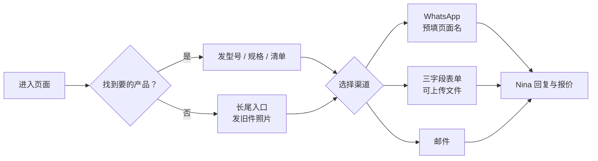

# 07 转化层 Conversion

转化层定义“采购者怎么联系 FHS”：入口放在哪里、表单怎么设计、询盘怎么分级、怎么交给 Nina。按钮与提示文案见 4.5。

## 7.1 Conversion Strategy 转化策略 ★

`已定`

**原则：最短路径到对话。**说服交给 Nina 本人，网站只负责让对口的采购者以最低门槛发出询价。采购者通常同时问很多家（2.4），网站要赢的是**进入第一批询价名单**。

| 杠杆 | FHS 做法 |
| --- | --- |
| 门槛 | 必填只有姓名、邮箱、需求；型号、照片、清单任意一种都可以 |
| 真人 | 每个联系模块都是 Nina 本人，有照片、名字、第一人称 |
| 确定性 | 提交前后都写明 24 小时内回复 |
| 接住目录外的需求 | 长尾入口：没找到也可以发照片 |
| 渠道选择 | WhatsApp、表单、邮件三选一，不强推某一个 |

**竞品做法**：询价表单 6/6 家都有，但只有 2 家做得好；具名对接人、回复时效、长尾入口在产品页几乎都没有（0–1/6）。 `网页展示`

**对标结论**：**超**（表单：更少必填 + 可上传照片）；**补**（具名对接人、长尾入口、回复时效）。

## 7.2 CTA Placement Spec 行动入口布局规范 ★

`已定`

| 模板 | 首屏 | 页中 | 页尾 | 移动端固定栏 | 长尾入口 |
| --- | --- | --- | --- | --- | --- |
| T1 首页 | 主按钮 + WhatsApp | 客户类型分流、替代入口 | C1 联系模块 | 有 | 有 |
| T2 栏目入口 | 主按钮 | — | C1 | 有 | 有 |
| T3 产品页 | 主按钮 | “怎么选”之后一条文字 CTA | C1（需求提示按品类改写） | 有 | 有 |
| T4 替代页 | **型号输入框**（首屏即表单） | 拍照指引之后 | C1 | 有 | — |
| T5 行业页 | 主按钮 | 每个工位产品表之后 | C1：*Send what you use now* | 有 | 有 |
| T6 客户类型页 | 主按钮 | 合作流程之后 | C1：清单上传 | 有 | — |
| T7 文章 | — | 产品插卡 | C1 精简版 | 有 | 有 |
| T9 询价页 | 完整表单 | — | WhatsApp、邮件、微信 | 只有 WhatsApp | — |

**规则**：

- 每页最多 3 处主 CTA（首屏、页中、页尾），不在每个模块后面都放按钮。
- 主按钮文案统一 *Send your model or photo*；T4、T6 用 4.5 的专用文案。
- 移动端固定栏：WhatsApp + *Send request*，点击 *Send request* 滚动到页尾表单，不跳页。
- 每个入口都带 `entry_location` 参数（9.2），用来判断哪个位置有效。

## 7.3 Lead Capture Form Spec 询盘表单规范 ★

`已定`

### 联系模块表单（全站）

| 字段 | 类型 | 必填 | 说明 |
| --- | --- | --- | --- |
| Name | 文本 | 是 | — |
| Email | 邮箱 | 是 | 格式校验 |
| Your request | 多行文本 | 是 | 占位提示按页面改写（4.5）；至少 10 个字符 |
| Attach files | 上传 | 否 | jpg、png、pdf、xlsx、csv、dwg；单个 ≤ 10 MB，最多 5 个 |
| 隐藏字段 | — | — | `page_id`、`template`、`entry_location`、页面 URL、来源（referrer）、UTM 参数 |

### 询价页 `quote` 的可选字段

在上面基础上增加，全部可选：Company、Country、WhatsApp number、Brand（现用品牌）、Part number、Quantity、Application。

**原则**：可选字段帮助 Nina 一次报准，但不能变成门槛。表单上方写明 *Only name, email and your request are required.*

### 状态与校验

| 状态 | 表现 |
| --- | --- |
| 校验失败 | 在字段下方提示，保留已填内容 |
| 提交中 | 按钮变为 *Sending…*，禁止重复提交 |
| 成功 | 原位显示 *Got it. Nina will reply within 24 hours.*，并提供 WhatsApp 链接；**服务器确认收到后**才显示并触发 `form_submit_success` |
| 失败 | 显示 *Something went wrong. Email us at sales@fhsfiltration.com* 和 WhatsApp 链接；触发 `form_submit_error` |

### 防垃圾

隐藏蜜罐字段 + 提交时间少于 3 秒视为机器 + 无感验证（如 Cloudflare Turnstile）+ 同一 IP 频率限制。**不用图片验证码**，它会直接降低询盘率。

### WhatsApp 与其他渠道

| 渠道 | 规格 |
| --- | --- |
| WhatsApp | `wa.me` 链接，预填 *Hi Nina, I'm looking at [页面名] on fhsfiltration.com.*；T4 预填品牌名。预填的页面名就是 Nina 记录来源的依据 |
| 邮件 | sales@fhsfiltration.com；点击触发 `email_click` |
| 微信 | 二维码只放询价页和桌面端联系模块 |

### 通知与存档

表单提交后：存入网站后台 → 邮件发到 sales@fhsfiltration.com（附件随邮件）→ 给 Nina 手机推送一条提醒（方式 `待确认`）→ 给访客自动回复确认邮件（署名 Nina）。

## 7.4 Lead Qualification Criteria 询盘分级标准

`已定` 分级帮助 Nina 安排回复顺序，也用于计算北极星的“有效询盘”。

| 级别 | 条件 | 是否计入有效询盘 | 回复优先级 |
| --- | --- | --- | --- |
| **A** | 5 个核心品类 + 有型号、规格、清单或数量中的至少一项 + 能看出是公司（公司邮箱、公司名或明确业务） | 是 | 最先 |
| **B** | 5 个核心品类，但信息不全（只有照片、只说需求、个人邮箱） | 是 | 其次 |
| **C** | 非核心品类（实验室、泵等配件）、个人零售量、学生或调研、明显只是收集报价 | 否 | 有空时回复 |
| 无效 | 垃圾信息、推销、招聘 | 否 | 不回复 |

> [!NOTE]
> 按 1.2 的定义，与 5 个核心品类相关的询盘都算有效，所以 A 和 B 都计入北极星。分级只决定先回谁，不决定回不回。

**Nina 的询盘记录表**（9.2 的数据来源）：日期、渠道（WhatsApp / 表单 / 邮件）、来源页面（`page_id` 或 WhatsApp 预填的页面名）、公司、国家、客户类型（经销商 / 集成商 / 终端 / 其他）、品类、级别、首次回复时间、进展（报价 / 样品 / 成交 / 无回音）。

## 7.5 Lead Handoff SLA 询盘交接与回复时效

| 项目 | 设定 | 状态 |
| --- | --- | --- |
| 对外承诺的回复时效 | **24 小时内回复**（照顾全球时差）；承诺的是回复，不是报价 | `已定`（Q03、IA-Q3） |
| “4 小时内报价” | 不使用：时差下做不到稳定兑现，而且报价常要先跟工厂核对 | `已定` |
| 通知方式 | 邮件 + 手机推送 | 推送方式 `待确认` |
| 非工作时间 | 自动回复写明 *within 24 hours*，不需要解释时区 | `已定` |
| 内部目标 | A 级询盘当天首次回复；首次回复时间记入询盘记录表 | `已定` |

> [!WARNING]
> 回复时效是采购者第一轮筛选的标准之一（2.4），也是 FHS 对外承诺里最容易被验证的一条。写出去就必须做到；做不到宁可不写具体数字。
